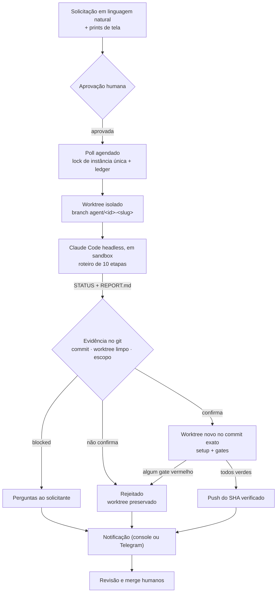

# evidence-gated-agent

Transforma uma solicitação **aprovada por um humano**, escrita em linguagem
natural e com prints de tela, numa **branch pronta para revisão**, implementada
por um agente de IA headless (Claude Code) num git worktree isolado.

A IA escreve o código, mas **não decide nada sobre publicá-lo**. O push é
decidido por um orquestrador determinístico, que cruza o que o agente declarou
com evidência objetiva: commit real no git, escopo respeitado e testes
reexecutados por conta própria, num checkout limpo do commit exato. O merge
continua humano.

> Este repositório é uma versão genérica e aberta de um padrão que aplico em
> projetos privados. Não contém código, dados nem regras de negócio de nenhum
> deles.

## Por que existe

Fazer um agente escrever código é a parte fácil. A parte difícil é o sistema
em volta dele, para que o código seja confiável o bastante para chegar a
produção. Este projeto organiza esse sistema em torno de três ideias:

- **O determinístico fica no código; o raciocínio fica no LLM.** Detecção,
  git, gates, push e notificação não passam por um modelo. O agente só recebe
  a parte que exige raciocínio: entender o pedido e implementar.
- **Humano nas duas pontas.** Nada roda sem aprovação explícita, e nada vai
  para a branch principal sem revisão e merge humanos. A autonomia vive só no
  meio.
- **Saber não agir é um resultado.** Uma solicitação ambígua vira perguntas
  objetivas ao solicitante (`blocked`), não código chutado.

## Como funciona



1. **Entrada** — cada solicitação é um JSON com título, descrição, solicitante,
   anexos e a aprovação (`approvedBy`, `approvedAt`). Sem aprovação, ela é
   ignorada. A fonte padrão é uma pasta (`FileRequestSource`); trocar por uma
   API é implementar `RequestSource`.
2. **Detecção idempotente** — o `poll` (agendado no cron) pega um lock de
   instância única e consulta o ledger: cada solicitação roda uma única vez.
3. **Isolamento** — um worktree descartável por solicitação, criado a partir da
   branch base remota. O clone principal nunca muda de branch.
4. **Agente com roteiro** — o prompt não é "implemente isso": é o
   [roteiro de 10 etapas](playbook/agent-playbook.md), com critério explícito de
   ambiguidade, testes, type-check, code-review do próprio diff, commit
   cirúrgico e um contrato de saída legível por máquina.
5. **Publicação por evidência** — o orquestrador confere o git, cria um
   worktree novo no commit exato que o agente produziu, roda o setup e os gates
   ali e, só se tudo estiver verde, faz push **daquele SHA**.
6. **Desfecho** — relatório do agente e motivos da decisão vão para o
   responsável; a revisão e o merge são humanos.

## A decisão de publicar

A decisão é uma função pura ([`decide`](src/gates.ts)). A autodeclaração do
agente é só a precondição; todo o resto é conferido:

| Condição | Por que existe |
| --- | --- |
| Agente declarou `implemented` | Precondição — nunca suficiente sozinha |
| Existe commit novo na branch | Pega o "fiz tudo" sem nada feito |
| Worktree limpo | Se sobrou algo sem commit, o commit não é a entrega completa |
| Nenhum caminho proibido no diff (renames inclusos) | `.env`, chaves e segredos ficam fora do alcance, mesmo renomeados |
| Gates verdes num **worktree novo, no commit exato** | Arquivos ignorados que o agente deixou, ou testes que mexem na branch, não influenciam o veredito |
| Pelo menos um gate configurado | Sem evidência, não há publicação — a config sem gates é recusada |

O push envia o SHA verificado, não "o que a branch tiver agora".

Arquivos que definem como os gates se comportam (`package.json`,
`*.config.*`, `tsconfig*.json`) ou como os agentes trabalham (`CLAUDE.md`,
`.claude/`) podem ser alterados — muitas vezes legitimamente —, mas aparecem
destacados na notificação para o revisor (`attentionPaths`).

### Desfechos

| Desfecho | Significado | Worktree |
| --- | --- | --- |
| `published` | Evidência confirmada, SHA enviado | removido |
| `ready` | Evidência confirmada, push desativado na config | mantido |
| `blocked` | Solicitação ambígua; o relatório traz as perguntas | removido |
| `rejected` | O agente declarou sucesso, mas a evidência não confirmou | mantido para inspeção |
| `failed` | Falha do agente (crash, timeout, contrato violado) ou da infraestrutura | mantido para inspeção |

## Guardrails

- **Humano nas pontas**: aprovação explícita na entrada; o orquestrador nunca
  faz merge, nunca usa `--force` e se recusa a fazer push na branch base.
- **Sandbox do agente e dos gates**: os dois rodam com um ambiente mínimo
  (`PATH`, `HOME`, locale e o que for liberado em `passEnv`) — tokens,
  credenciais de nuvem e o agente SSH do orquestrador não chegam a eles. O git
  lá dentro roda com `protocol.allow=never`: nenhum fetch, push ou clone
  funciona, nem por um script de teste que o agente tenha escrito.
- **Ferramentas restritas**: a configuração de exemplo libera só leitura,
  edição, testes, type-check e git local; ignora hooks, permissões e servidores
  MCP do usuário (`--setting-sources project`, `--strict-mcp-config`).
- **Solicitação é dado, não instrução**: o texto vai delimitado no prompt, os
  placeholders são preenchidos numa única passada e qualquer variação da tag
  delimitadora dentro do texto é neutralizada. Anexos são conferidos pelo
  caminho real (symlinks para fora da pasta são recusados).
- **Sem shell**: todo processo externo é criado com `spawn` e `shell: false`; o
  timeout derruba o grupo de processos inteiro, e parar o orquestrador
  (Ctrl+C, systemd) também para o agente.
- **Idempotência e recuperação**: o ledger registra `running` antes de qualquer
  trabalho, com escrita atômica. Se o processo morrer no meio, o próximo poll
  marca aquele run como `failed` — nunca fica pendurado, nunca é retentado em
  silêncio.
- **Identidade do agente**: os commits do agente saem com um autor próprio
  (`agent.gitAuthor`), separando o trabalho dele do humano no histórico.

### O que o sandbox não cobre

O sandbox estreita o que o agente alcança; não substitui isolamento de sistema
operacional. O agente precisa do `HOME` para as credenciais do Claude Code, e
portanto consegue ler arquivos do usuário que roda o poll. Em produção:

- rode o poll com um **usuário dedicado** (ou container), sem chaves além das
  necessárias;
- **proteja a branch base no servidor** (o orquestrador nunca a toca, mas a
  proteção não deve depender só dele);
- mantenha o **CI** como gate final do PR — o agente pode alterar a definição
  dos próprios testes, por isso essas mudanças são destacadas ao revisor.

A fronteira de confiança da entrada é quem pode escrever na fonte de
solicitações: a aprovação é um campo, e vale o controle de acesso da pasta (ou
da API) de onde ela vem.

## Validado com o Claude Code real

Além da suíte automatizada, o pipeline foi exercitado de ponta a ponta com o
Claude Code de verdade, num projeto Node de exemplo com um remote bare:

- **REQ-102** ("o relatório está errado, precisa mostrar a data certa"):
  `blocked` em 28 s, sem tocar em código, com sete perguntas objetivas ao
  solicitante.
- **REQ-101**, na primeira versão do texto: também `blocked` — e com razão. O
  pedido não dizia em qual fuso interpretar as datas, e um pedido feito às
  22h30 de Brasília cairia no dia seguinte em UTC. O agente mostrou o exemplo
  e perguntou.
- **REQ-101**, com o fuso e os casos-limite especificados (é a versão que está
  em `examples/inbox`): `published` em cerca de 2 minutos. O agente escreveu
  10 testes, um subagente revisou o diff e encontrou três pontos, corrigidos
  antes do commit. A branch publicada passou 12/12 testes num clone limpo.
  Custo da sessão: US$ 0,59.

## Auditoria

Cada tentativa guarda tudo o que é preciso para reconstruir a decisão:

```
~/.local/state/evidence-gated-agent/<repo>-<hash>/
├── ledger.json                      # uma entrada por solicitação (status, SHA, custo)
└── runs/REQ-101/2026-01-15T13-40-00-000Z/
    ├── request.json                 # a solicitação como chegou
    ├── attachments/                 # cópias dos anexos que o agente viu
    ├── setup.json                   # resultado do setup (ex.: npm ci)
    ├── prompt.md                    # o prompt exato
    ├── agent-output.json            # saída da sessão headless (custo, turnos)
    ├── agent-stderr.log             # diagnóstico quando o agente falha
    ├── STATUS / REPORT.md           # contrato escrito pelo agente
    ├── evidence.json                # SHA, arquivos, gates, atenção e a decisão
    └── summary.json                 # o que foi notificado
```

Um `retry` cria uma nova pasta de tentativa; a anterior é preservada. O
`workDir` fica fora do repositório alvo e do orquestrador por padrão — o Claude
Code lê `CLAUDE.md` subindo pelas pastas, e o agente não pode herdar as
instruções erradas.

## Uso

Requisitos: Node.js 20+, git e o [Claude Code](https://claude.com/claude-code)
instalado e autenticado na máquina que roda o poll.

```bash
npm install
cp agent.config.example.json agent.config.json   # ajuste repoPath, inboxDir e gates
npm run poll                                      # uma passada
npm run status                                    # estado do ledger
npm run retry -- REQ-102                          # libera para nova tentativa
```

Agendamento (a cada 15 minutos; o lock impede passadas sobrepostas):

```cron
*/15 * * * * cd /opt/evidence-gated-agent && npm run poll >> poll.log 2>&1
```

Para notificar no Telegram, use `"notifier": { "type": "telegram", "chatId": "<id>" }`
e defina `TELEGRAM_BOT_TOKEN` no ambiente — o token nunca vai no arquivo de
configuração, e o agente não o recebe. Se o Claude Code autentica por chave de
API, libere-a só para o agente com `"agent": { "passEnv": ["ANTHROPIC_API_KEY"] }`.

Em [`examples/inbox`](examples/inbox) há três solicitações: uma clara e
aprovada, com print (REQ-101); uma aprovada mas ambígua, que deve terminar em
`blocked` (REQ-102); e uma sem aprovação, que é ignorada (REQ-103).

## Testes

```bash
npm run check   # typecheck + 131 testes
```

- **Unitários** para cada peça: a função `decide` em todas as combinações, o
  contrato do runner (crash, timeout, status inválido), o prompt (variações da
  tag delimitadora, placeholders), o sandbox (com git real: commit funciona,
  push não), ledger, lock (inclusive a troca de dono no meio da tomada),
  escopo e o `exec` (grupo de processos, neto destacado).
- **Pipeline** com fakes para todos os desfechos, idempotência, lock,
  recuperação de crash, falha isolada por solicitação e anexos fora da pasta
  ou via symlink.
- **Ponta a ponta com git real**: remote bare, worktrees e pushes reais, e um
  [agente falso](test/fixtures/fake-agent.mjs) que se comporta como o
  `claude -p`. Cobre cada desfecho, inclusive um agente que tenta fazer push
  sozinho e ler segredos, um que deixa um arquivo ignorado para "ajudar" o
  gate, e um que esconde um `.env` — sem gastar crédito de API.

## Estrutura

```
src/
├── cli.ts          # poll · status · retry
├── pipeline.ts     # orquestra um poll e um run
├── gates.ts        # gates + decide()
├── sandbox.ts      # ambiente do agente e dos gates
├── agent/          # prompt a partir do roteiro + runner headless
├── git.ts          # worktrees, evidência no git, push do SHA
├── scope.ts        # caminhos proibidos e de atenção, nome de branch
├── state/          # ledger e lock
├── source.ts       # fonte de solicitações (pasta)
├── notify.ts       # console e Telegram
├── exec.ts         # único ponto que cria processos
└── config.ts · request.ts · deps.ts
playbook/agent-playbook.md   # o roteiro que o agente segue
```

## Limitações conhecidas e próximos passos

- Uma solicitação por vez. Paralelizar exige uma fila e um limite de worktrees
  simultâneos — o ledger e o lock já isolam o estado por solicitação.
- O desfecho é um push de branch; abrir o PR automaticamente, com o relatório
  como descrição, é o próximo passo natural.
- A verificação refaz o setup num worktree novo: mais lenta, mas é o que
  garante que o verificado é o publicado.
- Métricas que valem acompanhar: taxa de `published` aceito sem retrabalho na
  revisão, lead time da aprovação até a branch, apontamentos da revisão humana
  por entrega e taxa de `blocked` legítimo.

As decisões de projeto, inclusive o que ficou de fora de propósito, estão em
[DECISIONS.md](DECISIONS.md).

## Trabalhando neste repositório com IA

O [`CLAUDE.md`](CLAUDE.md) descreve os invariantes que não podem regredir, e
[`.claude/agents/guardiao-invariantes.md`](.claude/agents/guardiao-invariantes.md)
é um agente revisor que confere um diff contra eles antes do commit. Os dois
são versionados de propósito: fazem parte de como o projeto é mantido.

## Licença

[MIT](LICENSE)
